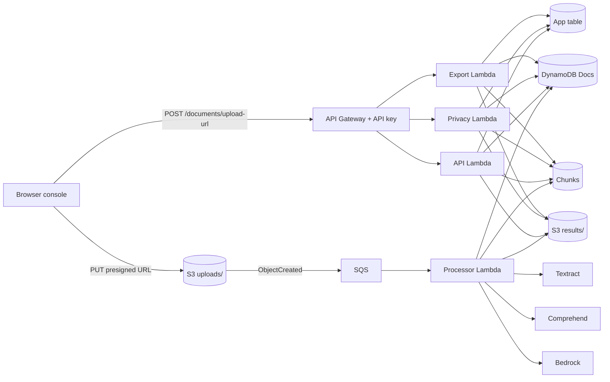
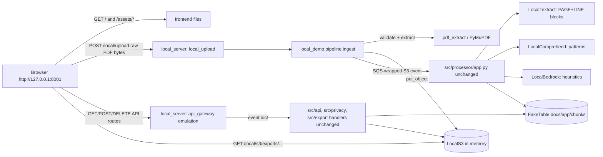
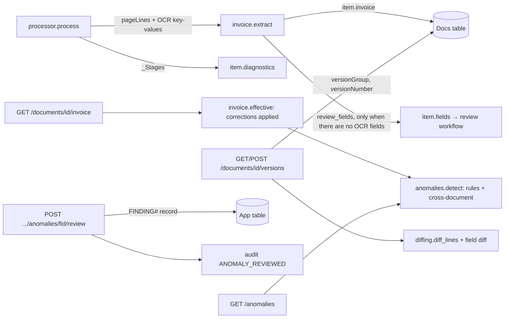

# DocIntel – project analysis (local demo edition)

This document describes the code **as it is now**. That covers the local-demo work (October 2026) and the
feature extension that followed it:

- deterministic invoice fields,
- evidence-backed answers,
- explainable anomalies,
- processing-stage diagnostics,
- version history.

The extension is detailed in section 12. Where the original behaviour differed, it is described under *Known
issues and root causes* (section 7). Line numbers refer to the files in this ZIP.

Contents

1. Summary
2. Repository inventory
3. Architecture overview (production vs local demo)
4. File and function walkthrough
5. Execution flows (with diagrams)
6. Mocked versus genuine functionality
7. Known issues: symptoms, root causes, fixes
8. Architecture and quality assessment
9. Testing: coverage and gaps
10. Proposed improvements
11. Remaining uncertainties
12. Feature extension: invoice fields, answers, anomalies, diagnostics, versions

---

## 1. Summary

DocIntel is an AWS serverless document-intelligence application: S3 → SQS → a **processor** Lambda (Textract,
Comprehend, Bedrock) → DynamoDB, plus three API-facing Lambdas (**API**, **Privacy**, **Export**) behind API
Gateway and a browser console. `local_server.py` runs all four handlers unchanged on one machine, replacing every
AWS client with an in-memory or offline stand-in through `docintel_common.aws.override()`.

The original local demo had three blocking problems:

- uploads could not work (the presigned URL pointed at a non-existent host),
- arbitrary PDFs could not be processed (the fake Textract only knew two scripted documents),
- every document received canned "AI" output, including an intentionally invented renewal date.

It also had several smaller defects: broken characters in the UI, the console needing an API URL, broken
download links, and a cross-site data-exposure risk.

All of these are fixed without changing any production contract. The fixes are:

- a local upload route,
- a PyMuPDF-backed Textract adapter,
- deterministic heuristics that are labelled as such, everywhere they appear,
- per-document provenance metadata,
- a redesigned console.

The production upload route (`POST /documents/upload-url` + PUT) also works locally now, because the local S3
issues same-machine presigned URLs.

The feature extension (section 12) adds five capabilities, all deterministic, none of them AI:

- **Invoice fields:** `docintel_common/invoice.py` extracts invoice fields with their page and source line,
  normalizes dates and amounts, and checks the arithmetic.
- **Anomaly findings:** `anomalies.py` turns those checks and cross-document comparisons into findings. Each
  finding names its rule, carries its evidence, and can be reviewed and audited.
- **Processing diagnostics:** the processor records measured stage timings, and repeat processing attempts are
  audited as retries rather than duplicate uploads.
- **Version history:** documents can be linked as versions, with field and text differences computed.
- **Labelled answers:** local answers are template-based or extractive, and say which.

All of it runs in the same handlers in AWS and locally.

---

## 2. Repository inventory

Legend for **Role**: App = application code deployed to AWS. Local = local-demo infrastructure. Test = tests and
fakes. Config = configuration and IaC. Docs = documentation.

### 2.1 Application code (`src/`, deployed to AWS)

| File | Role | Responsibility | Main symbols | Called by → calls |
|---|---|---|---|---|
| `src/processor/app.py` | App | SQS-triggered pipeline: claim → Textract → invoice parser → Comprehend → Bedrock → chunks → S3 result → DynamoDB, with per-stage diagnostics | `_Stages` L61, `handler` L89, `process` L102, `claim` L252, `extract` L273, `parse_blocks` L311, `analyze_text` L381, `summarize_and_classify` L433, `extract_key_dates` L479, `write_chunks` L528 | SQS (AWS) or `local_demo.pipeline` (local) / tests → `docintel_common.{aws,audit,bedrock,review,chunking,ddb,retrieval}` |
| `src/api/app.py` | App | REST router for the main API Lambda; original routes `upload-url`, list, get | `upload_url` L38, `list_docs` L55, `get_doc` L63, `ROUTES` L69 | API Gateway / `local_server.api_gateway` → `docintel_common.http.dispatch`, plus the modules below |
| `src/api/qa.py` | App | Grounded Q&A (`/ask`) and chat sessions | `load_chunks`, `retrieve`, `answer_question`, `ask`, `chat`, `list_sessions`, `get_session`, `delete_session` | api/app → `retrieval`, `grounding`, `bedrock`, Chunks + App tables |
| `src/api/review_api.py` | App | Field confidence view and human verification with optimistic locking | `list_fields`, `verify_field`, `list_verifications` | api/app → `review`, Docs + App tables, `audit` |
| `src/api/comparison.py` | App | Deterministic diff + LLM interpretation, cached | `compare`, `_semantic`, `get_comparison`, `list_for_doc` | api/app → `diffing`, `results`, `bedrock` |
| `src/api/search.py` | App | Cross-document BM25 (+ optional embeddings) search | `search`, `_load_chunks`, `_scan_segment` | api/app → `retrieval`, Chunks + Docs tables |
| `src/api/insights.py` | App | `/stats` dashboard metrics, audit queries | `stats`, `doc_audit`, `audit_by_day` | api/app → Docs + App tables |
| `src/api/invoices.py` | App | Invoice view (corrections applied), anomaly list, finding review decisions | `get_invoice` L52, `list_anomalies` L71, `review_finding` L88 | api/app → `anomalies`, `invoice`, Docs scan, App `FINDING#` records, `audit` |
| `src/api/versions.py` | App | Link a document as a revision; timeline with deterministic field and text differences | `link_version` L38, `list_versions` L121, `_field_diff` L77, `_text_diff` L100 | api/app → Docs table (`versionGroup`/`versionNumber`), `diffing`, `results` |
| `src/privacy/app.py` | App | PII detection (masked previews) and redacted copies | `detect_pii` L98, `redact` L124, `list_redactions` L184, `ROUTES` L196 | API Gateway → `pii`, `results`, S3 `redacted/` |
| `src/export/app.py` | App | Builds the export model; writes JSON/CSV/PDF to S3, returns a presigned URL | `build_model` L31, `export` L72 | API Gateway → `formats`, `review`, `results` |
| `src/export/formats.py` | App | Renders the model as JSON, CSV (formula-injection safe) or PDF | `to_json`, `to_csv`, `to_pdf` | export/app → `pdf_report` |
| `src/export/pdf_report.py` | App | Dependency-free PDF writer (Helvetica, WinAnsi) | `PdfReport`, `wrap` | formats, `scripts/make_sample_docs.py`, tests |
| `src/shared/docintel_common/aws.py` | App | Lazy boto3 clients/tables plus the `override()` hook used by tests and the local server | `client`, `table`, `new_table`, `override`, `reset_overrides` | everything |
| `.../http.py` | App | API Gateway helpers; `dispatch` maps `(method, resource)` to a function and converts errors | `resp`, `body_of`, `path_param`, `actor`, `dispatch`, `SAFE_ID` | all API handlers, local_server |
| `.../ddb.py` | App | float↔Decimal, pagination, time helpers | `to_ddb`, `from_ddb`, `query_all`, `scan_all` | everywhere |
| `.../audit.py` | App | Content-free audit events plus atomic counters | `record`, `bump`, `_sanitize` | all handlers |
| `.../bedrock.py` | App | Converse wrapper, JSON extraction, Titan embeddings | `converse`, `parse_json_object`, `embed`, `embed_many` | processor, qa, comparison, search |
| `.../chunking.py` | App | Page-aware chunks for retrieval | `build_chunks`, `page_lines_from_text` | processor, qa, results |
| `.../retrieval.py` | App | Tokeniser, BM25, cosine, ranking, snippets | `tokenize`, `BM25`, `rank`, `top_k`, `snippet` | qa, search, local heuristics |
| `.../grounding.py` | App | Q&A prompt + validation of citations and quotes | `SYSTEM_PROMPT`, `build_sources`, `interpret` | qa, local Bedrock stand-in |
| `.../review.py` | App | Threshold and field status logic; field views now carry `source`, `parseStatus` and `evidence` | `threshold`, `initial_status`, `field_view`, `summarize` | processor, review_api, export |
| `.../invoice.py` | App | Deterministic invoice parsing (labels, dates, amounts), normalization, arithmetic, tax-rate and date checks, applying corrections, review fields | `extract` L272, `validate` L345, `parse_date` L87, `parse_money` L158, `effective` L434, `review_fields` L456 | processor, invoices, versions, anomalies, export |
| `.../anomalies.py` | App | Explainable rules over invoice data and across documents; fixed severity table; stable finding ids | `RULES` L20, `detect` L150, `summarize` L229 | invoices, versions, export |
| `.../pii.py` | App | Chunked PII detection, masking, redaction | `detect`, `mask_preview`, `redact_ranges` | privacy |
| `.../diffing.py` | App | difflib line diff and field diff | `diff_lines`, `diff_fields`, `compare` | comparison |
| `.../results.py` | App | Loads `results/{docId}.json` from S3 (with legacy fallbacks) | `load`, `NotReady` | qa, comparison, privacy, export, local_server |
| `src/shared/requirements.txt` | Config | Intentionally empty (Lambda provides boto3) | – | – |

### 2.2 Local demo infrastructure (not deployed; nothing in `src/` imports it)

| File | Responsibility | Main symbols |
|---|---|---|
| `local_server.py` | FastAPI app: frontend, `/local/*` routes, API Gateway emulation, security guards, fixture seeding | `LocalEnv` L78, `match_route` L104, `create_app` L129, middleware L151, `/local/upload` L197, `/local/documents/{id}/retry` L257, `/local/s3` GET L277 / PUT L294, catch-all L310, `main` L340 |
| `local_demo/pdf_extract.py` | Validate PDF bytes and extract the embedded text with PyMuPDF | `extract` L67, `PdfError` L30, `looks_like_pdf`, `available`, `engine_version` |
| `local_demo/services.py` | Offline AWS stand-ins | `LocalS3` L47, `LocalTextract` L64, `pages_to_blocks` L101, `LocalBedrock` L122, `LocalComprehend` L179, `LocalAIUnavailable`, `OcrRequired` |
| `local_demo/heuristics.py` | Deterministic text heuristics (dates, category, summary, entities, key phrases, PII patterns, best-line answer) | `find_dates` L51, `key_dates` L90, `classify` L129, `extractive_summary` L146, `entities` L164, `key_phrases` L184, `pii_entities` L224, `best_line` L243 |
| `local_demo/pipeline.py` | Upload → S3 → real processor → provenance; upload and validation stages; duplicate detection; safe retry; fixture seeding; provenance vocabulary | `LocalPipeline.ingest` L160, `retry` L210, `seed_fixture` L246, `provenance` L86, `UploadError` L100, `sqs_s3_event` L112 |
| `requirements-local.txt` | fastapi, uvicorn, pymupdf==1.28.2, pytest, pyyaml | – |

### 2.3 Frontend

| File | Responsibility |
|---|---|
| `frontend/index.html` | Page shell: sidebar navigation, top bar, `<main id="view">`, upload `<dialog>`, toast region, inline SVG icon sprite. No inline script or style. |
| `frontend/assets/app.css` | Design tokens (colours, provenance colours, type), layout, components, responsive rules (1080 / 860 / 640 px), reduced-motion support |
| `frontend/assets/app.js` | Hash router, API client, all views (dashboard, documents, document detail with 7 tabs, review queue, search, compare, audit log, settings), upload dialog. Local and AWS modes. |

### 2.4 Tests, fixtures and samples

| File | Role | Notes |
|---|---|---|
| `tests/conftest.py` | Test | Puts `src/*` and `tests` on `sys.path`, sets env vars, provides the `env` fixture (`Env().install()`) |
| `tests/fakes.py` | Test (also used by local) | Strict in-memory DynamoDB (`FakeTable`: parses expressions, rejects floats, reserved words, unused placeholders), `FakeS3`, `FakeBedrock`, `FakeComprehend`, `FakeTextract`, `make_blocks` |
| `tests/helpers.py` | Test (also used by local) | `load_app`, scripted Bedrock `default_responder`, `Env`, `call`, `s3_event`, fixtures `INVOICE_A`/`INVOICE_B`, `ingest` |
| `tests/test_processor.py`, `test_api.py`, `test_privacy_export.py`, `test_shared.py`, `test_parse.py`, `test_template.py` | Test | Original suite: 61 tests (unchanged) |
| `tests/test_local_demo.py` | Test | 34 tests: heuristics, stand-ins, server routes, security, uploads, PDF edge cases, presigned emulation, frontend encoding, evidence-backed answers, stage diagnostics, retry |
| `tests/test_invoice.py` | Test (unit) | 36 tests: field extraction, date and money formats, ambiguity, arithmetic, tax rate, corrections, false-positive inputs |
| `tests/test_anomalies.py` | Test (unit + integration) | 15 tests: every rule, severities, duplicates, vendors, versions, corrections, review/audit API, JSON export |
| `tests/test_versions.py` | Test (integration) | 4 tests: linking, timeline differences, anomaly interplay, invalid links |
| `tests/integration/test_live_api.py` | Test | Live AWS test; skipped unless `DOCINTEL_API_URL`/`DOCINTEL_API_KEY` are set |
| `samples/sample_invoice_v1.pdf`, `v2.pdf` | Data | Real text PDFs ("Northwind Cloud Consulting"), generated by `scripts/make_sample_docs.py` |
| `scripts/make_sample_docs.py` | Tool | Regenerates the sample PDFs with `PdfReport` |
| `scripts/demo.py` | Tool | End-to-end CLI demo. It uses `upload-url` + PUT, so it now also works against the local server. |

### 2.5 Configuration and documentation

| File | Notes |
|---|---|
| `template.yaml` | SAM template (bucket, 3 tables, SQS + DLQ, 4 functions, API with key, alarms, dashboard). Unchanged. |
| `requirements-dev.txt` | pytest, pyyaml, boto3, cfn-lint. It does not list fastapi/uvicorn/pymupdf; those are in `requirements-local.txt`. |
| `pytest.ini` | `testpaths = tests` |
| `.gitignore`, `.gitattributes`, `.editorconfig` | `.gitattributes` and `.editorconfig` are new: they force UTF-8 and LF to prevent the encoding damage described in 7.4 |
| `README.md` | Deployment guide; now starts with a local-run section |
| `docs/API.md`, `docs/ARCHITECTURE.md`, `docs/UPGRADE_REPORT.md`, `docs/architecture.svg` | Production documentation. Only the frontend row in ARCHITECTURE.md was updated. |

Nothing was found to be obsolete. `tests/test_parse.py` overlaps with `test_processor.py::test_parse_blocks_keeps_confidence_and_pages`
but tests a hand-built block list, so it is complementary, not redundant.

---

## 3. Architecture overview

### 3.1 Production (AWS)



### 3.2 Local demo (this machine, one process)



The two run differently in a few ways:

- **Processing:** in AWS it is asynchronous, through S3 → SQS → processor. Locally it is synchronous, inside the
  upload request. The processor still receives the same SQS event shape, and its idempotent claim, status
  transitions, audit and chunking code all run.
- **Storage:** everything is in memory, so data is lost on restart.
- **AI and OCR:** there is no AI and no OCR (section 6).
- **Authentication:** API Gateway enforces the API key in AWS. Locally there is no API key; instead there are a
  Host check and an Origin check (section 4.1).

---

## 4. File and function walkthrough

### 4.1 `local_server.py`

**Startup sequence (`main` → `create_app`):**

1. Module import puts `ROOT`, `tests`, `src/privacy`, `src/export`, `src/api` and `src/shared` on `sys.path`. The
   handlers are loaded with `helpers.load_app()`, which imports each `app.py` from its file path under a unique
   module name, so the four `app.py` files never collide. The original server did a bare `import app` instead.
2. Environment variables are filled in with `setdefault`, so anything you set yourself wins:
   - table names and the bucket `local-bucket`,
   - `BEDROCK_MODEL_ID=local-heuristics`,
   - `EMBEDDING_MODEL_ID=""`, which turns embeddings off,
   - `CONFIDENCE_THRESHOLD=90`,
   - `CORS_ALLOWED_ORIGIN=http://127.0.0.1:8001`.

   The original server used `os.environ.update` and `CORS_ALLOWED_ORIGIN="*"`.
3. `create_app()` builds a `LocalEnv`: three `FakeTable`s, `LocalS3`, `LocalTextract`, `LocalBedrock` and
   `LocalComprehend`. It installs them with `aws.override(...)` and loads the processor, API, privacy and export
   handlers.
4. **Fixture seeding** (`LocalPipeline.seed_fixture`): `INVOICE_A`/`INVOICE_B` blocks from `tests/helpers.py`
   are registered on `LocalTextract.docs[key]` and pushed through the real processor with key
   `uploads/sample_invoice_v{1,2}.pdf` and etag `e1`. The processor's docId is
   `sha256(f"{bucket}/{key}/{etag}")[:32]` (`process`, L68), so with bucket `local-bucket` the IDs are always
   `98e7e792ab977a95c643e116e6b72d5c` and `ef241ea578c3e4829afa738f24164ed3`. They are **stable across restarts**,
   and `tests/test_local_demo.py::test_sample_ids_are_deterministic` checks this. Afterwards each record is
   relabelled "Demo fixture – Acme invoice A/B" and given fixture provenance. Set `DOCINTEL_SEED_FIXTURES=0` to
   skip seeding.
5. Routes are registered in order:
   - `/`, then the `/ui`, `/ui/`, `/ui/index.html` and `/index.html` redirects (307 to `/`), then `/favicon.ico` (204),
   - the `/assets` static mount,
   - the `/local/*` routes,
   - finally the catch-all API Gateway emulation.

   Order matters because the catch-all matches every path.
6. `uvicorn.run(app, host=127.0.0.1, port=8001)`. Console output is ASCII only (safe on a cp1252 Windows
   console). Audit log lines are quietened to WARNING.

**Request handling:**

- **Middleware `local_only_guard`** rejects two kinds of request:
  - any request whose `Host` is not `127.0.0.1:<port>`, `localhost:<port>` or the configured public host
    (status 400). This protects against DNS rebinding.
  - any non-GET request that carries an `Origin` from another site (status 403). This protects against
    cross-site request forgery from other open tabs.
- **`api_gateway` (catch-all for GET/POST/DELETE):**
  - `match_route` compares the path with each handler module's `ROUTES` templates, segment by segment, and turns
    `{param}` segments into `pathParameters`.
  - It builds the API Gateway proxy event: `httpMethod`, `resource` (the template, which is what `dispatch` keys
    on), `path`, `headers`, `queryStringParameters`, `body` and `requestContext.requestId`.
  - It calls `module.handler(event, None)` in a worker thread while holding a global lock, because the in-memory
    tables are not thread-safe.
  - It returns the handler's JSON body and status as-is, with the handler's headers minus content-length and
    content-type.
  - A body that is not UTF-8 gets 400. The original raised an uncaught error and returned 500.
  - An unknown route gets `404 {"error": "route not found: METHOD /path"}`.
- **`/local/upload` (POST):**
  - The raw request body is the file and `?fileName=` gives its name. No multipart and no python-multipart
    dependency.
  - The size limit is enforced twice: from `Content-Length` before reading, and again while streaming.
  - It then calls `pipeline.ingest`. Results are shown in section 5.3.
- **`/local/s3/{key}` GET/PUT:** emulates S3 presigned URLs. GET serves only `exports/` and `redacted/` objects.
  PUT accepts only `uploads/` and runs the same ingest. Both check `op=` and an `expires=` timestamp and return
  403 when the link is expired or used for the wrong operation.
- **Helper routes:**
  - `/local/config` tells the frontend it is in local mode and describes what runs locally.
  - `/local/documents/{id}/text` returns the extracted text page by page.
  - `/local/documents/{id}/original` streams the uploaded PDF back. Fixtures have no file, so they get 404.

**Same origin:** the HTML, the assets and every API call go to `http://127.0.0.1:8001`, so the browser never
sends a CORS preflight. The frontend detects local mode by calling `GET /local/config`.

### 4.2 Frontend (`frontend/`)

- **Structure:** a dark "ink" sidebar with seven destinations, each backed by real routes:
  - Dashboard (`/stats`, `/documents`)
  - Documents (`/documents`)
  - Review queue (`/documents` plus `/fields?status=REQUIRES_REVIEW` for each pending document)
  - Search (`/search`)
  - Compare (`/compare`)
  - Audit log (`/audit`)
  - Anomalies (`/anomalies`, review actions)
  - Settings (`/local/config` in local mode; API URL and key in AWS mode)

  A sticky top bar holds breadcrumbs and the upload button. On phones the sidebar becomes a drawer.

  Privacy and Export are not separate pages because the backend only offers them per document. They are tabs
  in the document view.
- **Document detail tabs:** Overview (now including *Processing stages* with Retry), Invoice checks, Fields & review,
  Extracted text (local only), Ask (labelled by answer mode), Versions, Privacy, Export, Audit.
  Tabs follow the ARIA tabs pattern: arrow keys, Home and End. Each tab is deep-linkable as
  `#/documents/<id>/<tab>`.
- **API client (`api()` in `app.js`):**
  - Local mode: same-origin calls, no key.
  - AWS mode: `S.base` and `x-api-key` from Settings, stored in localStorage.
  - Always sends `X-User-Id`, which feeds chat ownership and the audit trail.
  - Network failures and HTTP errors become readable messages, which views show with a Retry button.
- **Provenance display:**
  - `prov(doc, stage)` renders a badge from `doc.provenance.stages[stage]`: Genuine, Heuristic, Demo fixture or
    Unavailable, with the full explanation in the tooltip.
  - The Overview also shows a "How each result was produced" panel that you can expand.
  - Documents from AWS have no provenance, so they are labelled by service: Textract and Comprehend in green,
    "AI-generated" in blue.
- **Upload dialog:** a native `<dialog>`. It works in steps:
  1. You pick a file by drag-and-drop or the file picker.
  2. The browser checks the extension, an empty file and the size limit.
  3. "Upload and process" shows a spinner while waiting. There is no fake percentage.
  4. The result comes only from the server's answer: processed, duplicate, or a specific error with a matching
     title (OCR needed, damaged, password-protected, too large and so on).

  The error state offers "Try again" and "Choose another file". In AWS mode the dialog uses the presigned PUT and
  then polls `/documents` for up to 5 minutes.
- **Documents table:** filter by name, status, review state and source (local); sort on every column with
  `aria-sort`; page 10 rows at a time. On phones each row becomes a stacked card. Filtering and sorting happen in
  the browser because the API returns at most 50 documents (see 8).
- **Mapping to the backend:** the API returns status codes such as `COMPLETED`/`FAILED`/`PROCESSING` and
  `PENDING_REVIEW`/`REVIEWED`/`NOT_REQUIRED`. The UI shows them as plain labels ("Processed", "Needs review" and
  so on). In local mode, an uploaded PDF with `NOT_REQUIRED` is shown as "No fields", because nothing was
  extracted to review. Field statuses come from `review.field_view`.
- **Accessibility:**
  - skip link, landmarks, `aria-current` on the active nav item, visible `:focus-visible` outlines,
  - labelled inputs, including a hidden label for every per-field correction box,
  - `role=alert` on errors, `aria-live` on result regions, `prefers-reduced-motion` support,
  - colour is never the only signal: badges always carry text.
- **Encoding:** UTF-8 without BOM, LF line endings. A test enforces this.

### 4.3 API (`src/api/app.py` and modules)

Routing is a dict `ROUTES[(method, resource)]` consumed by `http.dispatch`. `dispatch` turns `ApiError` into its
status code, `JSONDecodeError` into 400, and any other exception into 500 "internal error" (logged). Path IDs must
match `^[A-Za-z0-9_-]{1,64}$`.

- `upload_url`:
  - sanitises the file name (`[^A-Za-z0-9._-]` becomes `_`, last 100 characters),
  - allows `.pdf/.png/.jpg/.jpeg/.tif/.tiff`,
  - builds the key `uploads/<uuid4>/<name>` and returns an S3 presigned PUT URL valid for 300 s.

  It cannot check the file itself: S3 receives the bytes directly. Locally the URL now points at `/local/s3/...`.
- `list_docs`: scans up to 100 items, sorts them by `createdAt` and returns the newest 50 with slim keys.
- `get_doc`: the full item minus `bucket`, `key`, `resultKey`, `startedAt` and `reviewVersion`; 404 if missing.
- Review: `GET /fields` (with `threshold` and `status` filters) and `POST /fields/{fieldId}/verify` (confirm or
  correct). Verify uses optimistic locking on `reviewVersion`, retries once, and writes an immutable `VERIFY#`
  record plus audit events. The extracted value itself is never overwritten.
- There is no authentication in code. API Gateway enforces the key. `X-User-Id` is a label the caller supplies,
  not a verified identity (as the README states).

### 4.4 Processor (`src/processor/app.py`)

1. `handler` loops over SQS records and parses the S3 notification inside each body. Any exception is reported
   in `batchItemFailures`, which lets SQS retry the message and eventually send it to the dead-letter queue.
2. `process`:
   - URL-decodes the key,
   - builds the docId from `bucket/key/etag`,
   - skips unsupported extensions,
   - claims the document (`claim`): a conditional `put_item` that succeeds if the record is new, `FAILED`, or a
     stale `PROCESSING` claim (older than 1000 s). This is the **idempotency** mechanism: the same object and
     etag means the same docId, and a `COMPLETED` record is never reprocessed.
3. `extract`:
   - images go through `analyze_document`,
   - PDFs go through the async `start_document_analysis` + `poll_textract`,
   - `parse_blocks` turns the blocks into text, `pageLines` (with each line's confidence), key-values and
     `fields` (confidence is the minimum of key and value confidence), tables, page count and average confidence.
4. An empty text layer raises "no text found in document".
5. `analyze_text` calls Comprehend for language, entities and key phrases. `summarize_and_classify` and
   `extract_key_dates` call Bedrock and **validate** the output: the category must come from a fixed list, ISO
   dates must be valid, and each item's `grounded` flag says whether its quoted source text appears verbatim in
   the document.
6. Each field gets `reviewStatus` from the threshold. `write_chunks` writes page-aware chunks plus one chunk per
   field, with optional embeddings, and removes chunks left over from an earlier attempt.
7. It writes `results/{docId}.json` to S3, then a single `update_item` that sets `COMPLETED` along with all
   derived attributes, and records the `DOCUMENT_PROCESSED` audit event.
8. On any exception it sets `FAILED` with `errorMessage` (500 characters max), records `DOCUMENT_FAILED`, and
   re-raises so SQS retries.

**Changed in this work:** entity `Score` may now be missing or `None`, in which case `score: null` is stored.
Real Comprehend always returns a score, so production behaviour is identical.

### 4.5 Privacy and export

- **Privacy** (`/documents/{id}/pii`, `/redact`, `/redactions`):
  - Flattens lines, `key: value` fields and table cells into segments and runs one detection pass.
  - Maps each offset back to a line, field or cell.
  - Returns masked previews only (`J*** S****`).
  - Redaction writes new `redacted/{docId}/{id}/redacted.{json,txt}` objects and a `REDACT#` record. Downloads
    are presigned URLs.
  - Locally the detection is pattern-based (section 6) and the download URLs work.
- **Export** (`/documents/{id}/export?format=json|csv|pdf&includeText=`):
  - `build_model` collects the item, the stored results, the field views and the summary.
  - The renderer writes `exports/{docId}/{id}.{fmt}` to S3 with `ContentDisposition` set and returns a 5-minute
    URL.
  - **Changed:** when an item carries `provenance`, the export uses its notice and confidence explanation instead
    of claiming "Amazon Bedrock / Comprehend", and the PDF footnote changes accordingly.

### 4.6 Shared modules

See table 2.1. Dependencies between them:

- `aws` is used by everything.
- `http` → `ddb`.
- `audit` → `aws`, `ddb`.
- `results` → `aws`, `chunking`.
- `grounding` → `bedrock`, `retrieval`.
- `review`, `diffing`, `pii` and `chunking` are pure logic.

The local stand-ins reuse `retrieval.tokenize`/`STOPWORDS` and `grounding.SYSTEM_PROMPT` and `NOT_ENOUGH_INFO`,
so local behaviour stays tied to the production code.

### 4.7 Test infrastructure

- **`Env`** builds fresh fakes and `install()` registers them with `aws.override`. The `env` fixture installs
  and uninstalls them around each test.
- **`make_blocks(pages, kvs, tables)`** builds Textract-shaped PAGE, LINE, WORD, KEY_VALUE_SET (KEY/VALUE),
  CELL and TABLE blocks with the confidences you supply.
- **`ingest(env, processor, key, spec)`** registers those blocks on `FakeTextract.docs[key]`, sends an SQS/S3
  event to the real processor, asserts there were no batch failures, and returns the docId.
- **`FakeS3`** is a dict of `(bucket, key)` → body plus metadata. Its `generate_presigned_url` returns
  `https://<bucket>.s3.fake/...`, which is fine for tests and was the cause of the upload failure.
- **`FakeTextract`** returns stored blocks by key and never reads a file.
- **`FakeBedrock` + `default_responder`** return **scripted** text chosen by matching the start of the prompt:
  - always "An invoice from Acme Cloud.",
  - one regex-derived deadline,
  - a deliberately invented renewal date ("March 3, 2027"), used to prove that ungrounded items get flagged,
  - a canned comparison.
- **`FakeComprehend`** finds names only from a three-name list, labels every capitalised phrase as
  ORGANIZATION with score 0.91, and always reports the language as English.
- **`FakeTable`** is strict on purpose: it parses expressions and rejects floats, reserved words and unused
  placeholders. This is the most valuable fake: it catches real DynamoDB mistakes.

**What the tests prove:** the handler logic, data contracts, DynamoDB expression correctness (as far as the fake
emulates DynamoDB), idempotency, review locking, the grounding checks, export formats, the wiring between routes
and `template.yaml`, and IAM boundaries.

**What they do not prove:** real Textract, Comprehend or Bedrock behaviour or quality, S3 or SQS semantics,
API Gateway auth, IAM in practice, performance at scale, or that any "AI" output is meaningful. Every AI response
in the original suite is scripted.

### 4.8 Configuration and documentation consistency

- The README originally said nothing about `local_server.py`. It now has a "Run it locally" section.
- `requirements-dev.txt` lacks fastapi, uvicorn and pymupdf. Rather than change the CI and dev contract, these
  were added in the new `requirements-local.txt`.
- The README said to open `frontend/index.html` and "paste the API URL"; that still works (AWS mode).
- `template.yaml` defaults `CorsAllowedOrigin` to `*`. That is a production concern documented in the README and
  was not changed. The local server no longer uses `*`.
- docs/ARCHITECTURE.md described a single-file frontend. That row is updated.

---

## 5. Execution flows

### 5.1 Application startup

`python local_server.py` → module imports and `sys.path` → env defaults → `main()` → `create_app()` →
`LocalEnv.install()` (`aws.override` × 7) → `load_app("processor")` → `seed_fixture` × 2 (real processor over
scripted blocks) → handler modules loaded → routes registered → `uvicorn.run` on 127.0.0.1:8001.

### 5.2 Frontend loading

1. `GET /` returns `index.html` (no-cache).
2. The browser loads `GET /assets/app.css` and `/assets/app.js` (StaticFiles).
3. `boot()` calls `GET /local/config`. A 200 response sets local mode, `S.base=""`, the set of fixture IDs and
   the mode box.
4. The hash router sends you to `#/dashboard`. `viewDashboard` requests `GET /stats` and `GET /documents` in
   parallel.
5. Each request goes through the middleware (Host check) to the catch-all.
6. `match_route` finds `("GET", "/stats")` in `api_app.ROUTES`, and the event goes to `api_app.handler`, then
   `dispatch`, then `insights.stats`.
7. `insights.stats` reads the `FakeTable` scan and the counters item, and `resp(200, ...)` serialises the result
   with `json_default`.
8. The browser renders the status ledger, recent documents, categories and so on from those two responses.

### 5.3 PDF upload (local)

```mermaid
sequenceDiagram
  participant U as Browser (upload dialog)
  participant S as local_server /local/upload
  participant L as LocalPipeline.ingest
  participant X as pdf_extract (PyMuPDF)
  participant S3 as LocalS3
  participant P as processor.handler (unchanged)
  participant T as LocalTextract / Comprehend / Bedrock
  participant D as FakeTable docs + chunks
  U->>S: POST /local/upload?fileName=a.pdf (raw bytes)
  S->>S: Content-Length / streamed size <= 20 MB else 413
  S->>L: ingest(name, bytes) [global lock, worker thread]
  L->>L: validate name (.pdf; images -> 415 OCR), size (0 -> 400)
  L->>X: extract(bytes): %PDF- header, open, password, pages <= 300, text per page
  X-->>L: pages[[lines]], charCount  (errors -> 415/422, no record created)
  L->>D: duplicate? same sha256 and COMPLETED -> 200 {duplicate:true}
  L->>S3: put_object(uploads/<sha256[:32]>/a.pdf) -> ETag
  L->>P: SQS-wrapped S3 event (bucket, key, etag)
  P->>D: claim (conditional put: PROCESSING)
  P->>T: start_document_analysis -> PAGE+LINE blocks (no confidence); empty -> OcrRequired
  P->>T: Comprehend (patterns), Bedrock prompts (heuristics)
  P->>D: chunks, results/{docId}.json in S3, update COMPLETED (or FAILED + errorMessage)
  P-->>L: batchItemFailures
  L->>D: SET provenance, classificationMethod, contentSha256, sizeBytes
  L-->>S: 201 {document, message} | 422 {code: ocr_required|processing_failed, document}
  S-->>U: JSON; dialog shows the server-confirmed state, list/dashboard re-render
```

The key is derived from the content hash plus the name. Re-uploading the same file under the same name after a
failure therefore produces the same docId, and the processor's claim (FAILED can be reclaimed) retries in place
instead of adding a row.

**AWS mode:** `POST /documents/upload-url` → PUT to S3 → S3 event → SQS → processor (asynchronous) → the console
polls `/documents` for the file name.

### 5.4 Document details

`#/documents/<id>` → `GET /documents/<id>` → `get_doc` → `public(item)`. The Overview tab shows:

- summary, key dates and actions, entities and phrases, each with a provenance badge,
- classification (category, method, intent, language),
- processing facts,
- the provenance panel.

Other tabs load on demand:

- Fields: `GET /fields` and `GET /verifications`.
- Extracted text: `GET /local/documents/<id>/text`.
- Ask: `GET /chat`, then `POST /chat` for each question.
- Privacy: `POST /pii`, `POST /redact`, `GET /redactions`.
- Export: `GET /export`, then the link to `/local/s3/exports/...`.
- Audit: `GET /audit`.

### 5.5 Field review

The user enters a correction:

1. `POST /documents/<id>/fields/<fid>/verify {"action":"correct","correctedValue":"41 USD"}`.
2. `review_api.verify_field` validates the action, the value and `expectedVersion` (non-integers now get 400),
   then loads the document with a consistent read.
3. It builds the verification record and recomputes the summary.
4. A conditional `update_item` on `reviewVersion` (retried once) writes it, followed by an immutable `VERIFY#`
   record and the `FIELD_VERIFIED` (and `RESULT_MODIFIED`) audit events.
5. The response returns the updated field and the review summary.
6. The UI shows a toast, re-fetches the document and the field list, and updates the review-queue badge.

Only documents that have fields can be reviewed. In local mode that means the scripted fixture.

### 5.6 Privacy and exports

- **PII:** `privacy._load` (must be COMPLETED) → `results.load` → `_segments` → `pii.detect` →
  `LocalComprehend.detect_pii_entities` (patterns) → masked previews plus `piiSummary` on the item.
- **Redact:** same detection → `redact_ranges` → rebuild the extraction structure → 2 S3 objects + `REDACT#`
  record → presigned URLs that point at `/local/s3/redacted/...`.
- **Export:** `build_model` → `to_json`/`to_csv`/`to_pdf` → S3 `exports/...` → URL → `GET /local/s3/exports/...`
  serves the bytes with the stored `Content-Disposition`.

### 5.7 Failure paths

| Situation | Behaviour |
|---|---|
| Not a PDF (no `%PDF-`), even if named .pdf | 415 `not_a_pdf`, no record |
| Damaged PDF | 422 `malformed_pdf`, no record |
| Password-protected | 422 `encrypted_pdf`, no record |
| Empty file / over 20 MB / over 300 pages | 400 `empty_file` / 413 `too_large` / 413 `too_many_pages` |
| Image or other extension | 415 `ocr_required` / `unsupported_type` |
| PDF without a text layer | Processor marks FAILED with an OCR explanation; 422 `ocr_required` and the FAILED record stays visible in the list |
| PyMuPDF not installed | Server starts with a warning; uploads get 503 `extractor_unavailable`; Settings and the upload dialog say how to fix it |
| Processor exception | FAILED + `errorMessage`; 422 `processing_failed`; audit `DOCUMENT_FAILED` |
| Duplicate upload (same bytes) | 200 `duplicate: true` with the existing document |
| Same S3 event twice | `claim` fails the condition, so the duplicate is skipped |
| Unknown route | 404 JSON with method and path |
| Unknown document | 404 "document not found" (API) / error panel with Retry (UI) |
| Document not COMPLETED for ask/fields/pii/export | 409 |
| Invalid JSON / non-UTF-8 body | 400 |
| Expired or wrong-operation download link | 403 |
| Cross-site POST / foreign Host header | 403 / 400 |
| Server stopped while the UI is open | "Cannot reach the local server. Check that local_server.py is still running" with Retry |
| AI comparison locally | factual diff returned; `aiInterpretation.status = FAILED, error = LocalAIUnavailable`, shown as "Unavailable" |

---

## 6. Mocked versus genuine functionality (local mode)

| Stage | Status | What actually happens |
|---|---|---|
| PDF text extraction | **Genuine** | PyMuPDF reads the embedded text layer page by page (`get_text("text", sort=True)`). No OCR, no layout analysis. |
| Page boundaries, chunking, BM25 retrieval and search | **Genuine** | Production code over real extracted text. Embeddings are off: the test fake's hashed "embeddings" are not semantic, so they are not used. |
| Field review workflow, audit trail, exports, redaction mechanics, deterministic diff | **Genuine** | Production code. |
| Tables and OCR confidence (uploads) | **Unavailable** | Need Textract. `tableCount=0`, `avgOcrConfidence=null`. |
| Invoice fields (uploads and fixtures) | **Heuristic** | `invoice.py`: values next to known labels (extracted), the vendor from the heading or the currency from symbols (inferred), conflicting candidates (ambiguous), unparseable values (invalid), otherwise missing. Raw text, page and source line are kept. For uploads these become the review fields, with no confidence score. |
| Arithmetic, tax-rate, date-order and negative-amount checks; anomaly rules; version differences | **Genuine** | Exact Decimal arithmetic and fixed rules over the parsed values (the inputs may be heuristic, and the UI says so). |
| Stage durations | **Genuine** | Measured with `time.perf_counter()` on each run; the upload stage is not timed and fixtures are labelled. |
| Form fields, tables, confidence (seeded records) | **Fixture** | Scripted test data, labelled "Demo fixture" everywhere. |
| Summary | **Heuristic** | Extractive: the first line plus up to two information-dense lines, verbatim. |
| Category | **Heuristic** | Keyword cues, at least 2 needed, otherwise `other`. `classificationMethod = "Keyword heuristic (local demo)"`. |
| Key dates | **Heuristic** | Regex dates (ISO only when unambiguous); type guessed from words on the line; `sourceText` is the line, so `grounded` is genuinely true. |
| Entities | **Heuristic** | DATE and QUANTITY by regex, `score: null`. No people or organisations. |
| Key phrases | **Heuristic** | Most frequent content words. |
| Q&A | **Heuristic** | BM25 retrieval (genuine). Then either a *template* answer from a retrieved field passage plus the verbatim line that contains its value, an *extractive* answer (best line, at least 50% of the question's terms), or "not found". `answerMode` says which. |
| PII | **Heuristic** | Regex: email, phone, SSN-like, account number after "Account Number:", street address, Luhn-valid cards, Indian PAN. **No names.** Score 1.0 means "pattern matched", and the UI shows "Pattern match", not a score. |
| Intent, required actions, AI comparison, language detection | **Unavailable** | Shown as unavailable; `intent=""`, `actions=[]`, language recorded as the default `en`. |

**What genuine semantic analysis would need.** In the AWS deployment this is Textract, Comprehend and Bedrock.
Two offline options exist; neither is required for the demo and neither was added:

- **Tesseract OCR** (via `pytesseract` or PyMuPDF's OCR integration) for scanned PDFs.
- **A local LLM** served by Ollama (for example a 7–8B instruct model) behind the same `LocalBedrock.converse`
  interface. That would give real summaries, intent, actions and comparisons. It costs a multi-GB download,
  needs 8–16 GB RAM, and makes processing slower.

A paid hosted API was not added (it needs your approval).

---

## 7. Known issues: symptoms, root causes, fixes

All entries marked **Confirmed** were reproduced against the original code (server run plus requests) or are
evident from the code with no ambiguity.

### 7.1 PDF upload fails – Confirmed

- **Symptom:** `POST /documents/upload-url` returns 200; the PUT fails with `ERR_NAME_NOT_RESOLVED`; a preflight
  failure appears in the network panel.
- **Code path:**
  - `frontend/index.html` `#uploadBtn` handler: `fetch(up.uploadUrl, {method:"PUT"})`.
  - `src/api/app.py` `upload_url` calls `aws.client("s3").generate_presigned_url`.
  - `tests/fakes.py` `FakeS3.generate_presigned_url` returns `https://local-bucket.s3.fake/...`.
- **Cause:** the fake returns a placeholder host that does not exist. Even if the host resolved, the original
  `local_server.py` had no PUT route (it answered 405) and no code linking an upload to the processor. The PUT is
  cross-origin with a `Content-Type: application/pdf` header, so the browser sends a preflight first, which also
  fails.
- **Fix:**
  - `POST /local/upload` (same origin, raw bytes, validated, processed synchronously). The UI uses this in local
    mode.
  - `LocalS3.generate_presigned_url` returns `http://127.0.0.1:8001/local/s3/...` and `PUT /local/s3/{key}`
    ingests, so the production flow (and `scripts/demo.py`) also works locally.
  - The production route is unchanged.
- **Affected:** export and redaction downloads, which had the same cause (7.3).
- **Tests:** `test_upload_real_pdf_end_to_end`, `test_presigned_put_flow_emulates_s3`,
  `test_upload_validation_without_pymupdf_dependency`.

### 7.2 Arbitrary PDFs cannot be processed – Confirmed

- **Cause:** `FakeTextract.start_document_analysis/get_document_analysis` look the key up in a dict filled only
  by `ingest()`. An uploaded key raises `KeyError`, and the processor marks the document FAILED.
- **Fix:** `LocalTextract` reads the stored bytes and turns PyMuPDF's lines into PAGE and LINE blocks only, so the
  processor's Textract contract is untouched. It deliberately emits no KEY_VALUE_SET or TABLE blocks and no
  confidence. Validation (header, damage, password, page limit, empty text) happens before or inside
  extraction, with specific error codes.
- **Tests:** `test_multi_page_pdf_keeps_page_boundaries`, `test_text_free_pdf_is_reported_as_needing_ocr`,
  `test_damaged_and_protected_pdfs_are_rejected_without_records`.

### 7.3 Download links (export, redaction) are dead – Confirmed

- **Cause:** the same `FakeS3` presigned-URL placeholder.
- **Fix:** `LocalS3` plus `GET /local/s3/{key}`, restricted to `exports/` and `redacted/`, with expiry enforced.
- **Test:** `test_downstream_features_on_uploaded_pdf`.

### 7.4 Broken characters in the UI (`–`, `…`, `·`, `🎉`) – Confirmed

- **Evidence:** the original `index.html` has a UTF-8 BOM, 20 lines containing `â€` sequences, one trailing CRLF
  line, and a newer modification date than every other file.
- **Cause:** the UTF-8 file was read as Windows-1252 and written back as UTF-8. This is typical of
  `Get-Content | Set-Content` in Windows PowerShell 5.1. That this was the specific tool is a hypothesis; the
  double encoding itself is confirmed.
- **Fix:** the new frontend files are clean UTF-8 (no BOM, LF). `.gitattributes` and `.editorconfig` were added,
  and `test_frontend_files_are_clean_utf8` guards against a repeat. This test caught the BOM being carried over
  during the rewrite.

### 7.5 Canned and invented AI output – Confirmed

- **Cause:** the local server installed the test `Env` with `default_responder`. Every document got the summary
  "An invoice from Acme Cloud." and the invented key date "March 3, 2027" (flagged ungrounded, but still shown).
  The comparison was canned, Comprehend gave ORGANIZATION 0.91 to any capitalised phrase, hashed bag-of-words
  vectors were labelled "hybrid/semantic" search, and the token counts were fake.
- **Fix:**
  - `LocalBedrock` and `LocalComprehend` use deterministic heuristics or raise `LocalAIUnavailable`.
  - Embeddings are off.
  - Token usage is 0.
  - Per-document `provenance`, shown in the UI and in exports.
  - Fixtures renamed so they cannot be mistaken for `samples/*.pdf`.
- **Tests:** `test_config_and_fixtures_are_labelled`, `test_local_bedrock_handles_every_production_prompt`
  (drives the stand-in with the **real** prompts, so drift is caught), `test_local_comprehend_reports_no_fake_scores`.

### 7.6 Seeded "sample_invoice_v1.pdf" is not the sample PDF – Confirmed

- **Symptom:** the record named `sample_invoice_v1.pdf` contains "Acme Cloud Services Invoice", but
  `samples/sample_invoice_v1.pdf` is a "Northwind Cloud Consulting" invoice.
- **Cause:** the records come from `INVOICE_A`/`INVOICE_B` in `tests/helpers.py`, stored under those S3 keys.
- **Fix:** keys (and so docIds) unchanged; display names are now "Demo fixture – Acme invoice A/B" with fixture
  provenance. You can upload the real samples.

### 7.7 Console requires an API URL locally – Confirmed

- **Cause:** in the original frontend, `api()` threw "Set the API URL first" when `cfg.url` was empty, and
  `loadDocs()` ran only when a URL was saved. The supplied version sends `x-api-key` only when one is configured,
  but still needs a URL.
- **Fix:** the console detects the local server through `/local/config` and uses the same origin automatically.

### 7.8 `/ui/index.html` returns 404 – Confirmed

- **Fix:** `/ui`, `/ui/`, `/ui/index.html` and `/index.html` redirect to `/`.

### 7.9 Any website could read local data – Confirmed

- **Cause:** handlers send `Access-Control-Allow-Origin: *` (`CORS_ALLOWED_ORIGIN="*"`). Any page open in the
  browser could `fetch("http://127.0.0.1:8001/documents")` and read the result. POST routes parse `text/plain`
  bodies as JSON, so cross-site form posts could also change data.
- **Fix:** CORS origin set to the server's own origin, an Origin check on non-GET requests, and a Host check.
- **Test:** `test_cross_origin_writes_and_foreign_hosts_are_rejected`.

### 7.10 Non-integer `expectedVersion` gives a 500 – Confirmed

- **Cause:** `int(body["expectedVersion"])` raised `ValueError`, which `dispatch` caught as an unknown error.
- **Fix:** validated, and returns 400. Production code change, backward compatible.
- **Test:** `test_verify_rejects_non_integer_expected_version`.

### 7.11 Non-UTF-8 body crashes the local gateway – Confirmed

- **Cause:** `raw_body.decode("utf-8")` sat outside any error handling.
- **Fix:** returns 400.
- **Test:** `test_non_utf8_api_body_is_a_400`.

### 7.12 Hypotheses (not confirmed, not changed)

- The original export opened its link with `window.open` after an `await`. Some browsers block that as a pop-up.
  The new UI shows a download link instead, so this no longer matters.
- `list_docs` scans with `Limit=100` and then sorts. Beyond 100 documents in DynamoDB the "most recent" list is
  not actually the most recent. This is evident from the code and matters only in production at scale; it is
  documented, not changed (fixing it needs a GSI).

---

## 8. Architecture and quality assessment

| Area | Assessment | Severity |
|---|---|---|
| Separation of concerns | Good. Handlers are thin; shared logic is pure and tested; all AWS access goes through `aws.py`, which is what makes local and test substitution clean. | – |
| Coupling | The local server imports `tests/fakes.py` and `tests/helpers.py` (FakeTable, fixtures). This reuses the strict DynamoDB emulation instead of duplicating 600 lines, but test edits can affect the demo. `LocalBedrock` recognises prompts by their first words; a test drives it with the real prompts to catch drift. | Medium |
| Idempotency and consistency | Strong in production: conditional claim, keyed chunk writes with stale-chunk cleanup, optimistic locking on review, cached comparisons. Local adds duplicate detection by content hash and a global lock. | – |
| Error handling and validation | Generally strong. Fixed: non-integer `expectedVersion`, non-UTF-8 body. Uploads now validated by content, not name. | Fixed |
| Security (local) | Fixed: wildcard CORS, CSRF and DNS-rebinding exposure. Binds to 127.0.0.1 only. No path traversal is possible because S3 is a dict, not the filesystem. The API key is not enforced locally (by design). | Fixed |
| Security (production) | `X-User-Id` is caller-asserted; the default CORS origin is `*`. Both are documented in the README. | Medium (unchanged) |
| Mock/real boundary | Previously invisible; now explicit per stage (`provenance`) and in `/local/config`. | Fixed |
| Frontend maintainability | Was one 430-line file with inline CSS and JS and mojibake. Now three files: tokens in CSS, views as functions, one API client, consistent escaping (`esc()` on every interpolated value). Still a hand-written DOM-string UI with no framework, which is appropriate for a no-build tool. | – |
| Accessibility | Keyboard-operable tabs, sort and dialog; focus visible; labels; live regions. Not audited with a screen reader. | Low |
| Tests | 85 tests: 61 original + 24 new. See 9. | – |
| Performance | Fine at demo scale. `/stats`, `/documents`, `/search` and duplicate detection scan whole tables; processing is synchronous and serialised by the lock (a 300-page PDF blocks other requests for a few seconds). | Low (local) |
| Risks of the changes | Processor and export edits are additive (null score; provenance-aware labels). The review_api change only turns a 500 into a 400. Everything else is outside `src/`. | Low |

---

## 9. Testing: coverage and gaps

How to run:

```
python -m pytest
```

| Environment | Result |
|---|---|
| This sandbox, without PyMuPDF | 139 passed, 12 skipped (11 need PyMuPDF, 1 live-AWS) |
| This sandbox, with a PyMuPDF stand-in | 150 passed, 1 skipped |
| Your Windows machine (PyMuPDF 1.28.2 installed) | Expected: 150 passed, 1 skipped (not run here) |

The stand-in used here was built on pypdf. It existed only in this sandbox because PyPI was unreachable, and it
is not shipped with the project.

How the 151 tests divide by kind:

- **Unit tests** (pure functions, no I/O): `test_invoice.py` (36), `test_shared.py` (20), `test_parse.py` (2),
  and the rule tests at the top of `test_anomalies.py` (10).
- **Integration tests with local substitutes** (real handlers, in-memory fakes, in-process HTTP):
  `test_api.py` (16), `test_processor.py` (7), `test_privacy_export.py` (9), `test_template.py` (7),
  `test_versions.py` (4), the API tests in `test_anomalies.py` (5), and `test_local_demo.py` (34, of which
  11 need PyMuPDF).
- **Tests requiring real external services:** `tests/integration/test_live_api.py` (1), skipped unless a deployed
  stack is configured.

**What the extension's tests cover:**

- valid, multi-page, empty, oversized, unsupported, malformed, encrypted and text-free PDFs,
- missing, ambiguous, invalid and inferred fields,
- six date formats plus ambiguous, impossible and two-digit-year dates,
- US, EU and Indian number formats, currency symbols and codes, parenthesised negatives, percentages that are not
  amounts,
- arithmetic: correct, wrong, rounding tolerance, unexplained difference, with discount and shipping, tax-rate
  mismatch, mixed currencies,
- false-positive inputs: a consistent invoice, a contract, a letter, different vendors sharing an invoice number,
  linked versions,
- every anomaly rule, the review workflow (dismiss needs a note, reopen), audit entries without note text, and
  corrections resolving findings,
- template, extractive and not-found answers; Bedrock answers labelled `llm`; verified quotes; no duplicate search
  snippets,
- failure at each stage, retry without a duplicate record or duplicate "uploaded" event, OCR failures refused for
  retry, duplicate SQS delivery,
- version linking, the timeline, differences, identical text, and invalid links.

**Browser verification (Playwright + Chromium, run in this sandbox, not part of the repo):** 15 regression checks
from the first iteration (one was updated, because the review queue now also contains uploaded invoices) plus 14
new checks:

- dismissing without a note is refused; dismiss, then reopen,
- the audit log shows anomaly reviews,
- correcting a total resolves the arithmetic finding,
- template answer label and not-found label,
- a duplicate upload is detected before any version link is attempted,
- linking from the Versions tab, and "Full comparison" preselects both documents,
- failed stages render with no Retry offered for an OCR failure,
- the dashboard findings panel,
- zero JavaScript errors.

Screenshots were taken at 1440, 1366, 820 and 390 px.

**Gaps:**

- PyMuPDF itself was not executed in this sandbox. The code uses only documented PyMuPDF APIs, and the six
  PyMuPDF tests will exercise them on your machine.
- No screen-reader testing.
- No real-AWS run (it needs a deployed stack).
- The frontend has no unit tests (only the scripted browser checks above, which are not in the repo).
- The invoice parser was tested on synthetic invoices and the two sample PDFs only. Real-world layouts (multi-column
  tables, labels and values on different lines, scanned text) will produce more "not found" and "ambiguous"
  results; the parser is designed to report that rather than guess.

---

## 10. Proposed improvements (not implemented; in priority order)

1. **OCR for scanned PDFs** via Tesseract (optional dependency, auto-detected, labelled "OCR (Tesseract)" with
   real per-line confidence). This would also give genuine confidence scores for review.
2. **An optional local LLM** (Ollama) behind `LocalBedrock` for real summaries, intent, actions and comparison.
   It must stay optional and clearly labelled.
3. **Persistence for the local demo** (a JSON or SQLite snapshot of the fake tables and S3 dict on shutdown), so
   uploads survive a restart.
4. **Move the fakes the server needs** (`FakeTable`, `FakeS3`, fixtures) from `tests/` into `local_demo/` and
   have the tests import them from there.
5. **Production:** a GSI on `createdAt` for `/documents` and `/stats`; a Cognito authorizer to replace the
   caller-asserted `X-User-Id`; set `CorsAllowedOrigin` per environment.
6. **Line-item tables** (quantity × unit price = line total) would let the arithmetic check reach line level; it
   needs table extraction, which the local demo does not have.
7. **Cross-document questions** ("which invoices are due in October?") over the structured invoice fields, rather
   than over text.
8. **Unlinking versions** and choosing where a version sits in the chain (versions are currently only appended).
9. **Invoice fields in the CSV and PDF exports** (they are in the JSON export only).

---

## 11. Remaining uncertainties

- **PyMuPDF specifics on your machine:**
  - which exception a damaged PDF raises (all exceptions are caught),
  - whether MuPDF "repairs" some damaged files into readable ones (that would be accepted, which is correct),
  - the exact line order from `sort=True` on complex layouts.

  The sandbox used a pypdf-based stand-in.
- **Bahnschrift** (the heading font) ships with Windows 10/11; other systems fall back to system sans fonts.
- **Your original brief was truncated** at section 7 ("All frontend API…"). Requirements after that point may not
  be reflected; see `CHANGELOG_LOCAL_DEMO.md` for the assumptions made.
- **The AWS deployment path** was not run. Production code changes are minimal and covered by the offline suite.
- **Behaviour change in production if deployed:** an invoice whose Textract output contains *no* key-value pairs
  now gets parser fields for review, and with them status `PENDING_REVIEW`. Documents with Textract fields are
  unaffected except for the new `invoice` and `diagnostics` attributes and new API routes, which are wired in
  `template.yaml` (checked by `test_template.py`).

---

## 12. Feature extension: invoice fields, answers, anomalies, diagnostics, versions

### 12.1 Where the new code sits



Everything new is in the production code paths (`src/`), wired in `template.yaml`, and pure Python. The local
demo only adds `POST /local/documents/{id}/retry`, and labels for the heuristic inputs.

### 12.2 Feature A: structured invoice fields

**Fields:**

- invoice number, vendor, invoice date, due date, currency,
- subtotal, tax (with rate), discount, shipping, total,
- payment terms.

**How a line is parsed:**

- One regular expression lists every label alternative, longest first, so "Total Amount Due" beats "Total".
  Weak labels ("Date", "Terms", "From", "Currency", "Vendor") need a colon after them.
- Each label's value is the text up to the next label on the same line, so several labels can share a line.
  Payment terms keep their whole sentence even when it contains "due by …".
- When the same field is found several times, the label's priority decides. Equal priority with different
  values makes the field `ambiguous`, and every candidate is listed.

**Statuses:** `extracted`, `inferred` (vendor from the heading; currency from amount symbols), `ambiguous`,
`invalid`, `missing`, and `corrected` (after human review).

**Normalization** (the raw text is always kept):

- **Dates:**
  - "15 Oct 2026", "October 15, 2026", ISO, and `/`, `.` or `-` numeric forms are all read.
  - Numeric forms where both parts are 12 or less (e.g. 04/05/2026) are ambiguous; both readings are listed.
  - Impossible dates (31/02) are invalid.
  - A two-digit year is read as 20xx, with a note.
- **Amounts:**
  - Separators: `1,234.56`, `1.234,56`, Indian `1,23,456`.
  - `1.234` is ambiguous (1.234 or 1234).
  - Space-grouped numbers are not guessed.
  - Currencies come from symbols ($ → USD, with a note) or codes; `Rs.` → INR.
  - Parentheses and a leading minus mean negative; percentages are excluded.
  - Arithmetic uses `Decimal`; values are stored as strings.

**Checks** (`validate`):

| Check | Statuses and rule |
|---|---|
| arithmetic | `pass` / `fail` / `warn` / `skipped`. Subtotal + tax + shipping − discount = total within 0.01. A difference with no tax, shipping or discount line is a `warn`, not a `fail`. Skipped when there are mixed currencies or missing inputs. |
| taxRate | The rate from "Tax (18%)", within 0.02, on either the subtotal or the subtotal after discount |
| dateOrder | The due date must not be before the invoice date |
| negativeAmounts | Any negative amount is a `warn`, because credit notes are legitimate |

**Integration:**

- The processor stores `item.invoice`.
- When OCR produced no key-value fields (local uploads), `review_fields` adds the parsed fields to `item.fields`,
  with ids `inv_<name>` and `confidence: null`. They then go through the existing verify endpoint and its
  immutable trail.
- Review status becomes `PENDING_REVIEW` when a field has no score. This aligns the processor with
  `review.summarize`, which already counted unscored fields as pending.
- Textract key-value pairs are also fed to the parser as `Key: Value` lines, so fixture and AWS documents get
  invoice numbers from their form data.

### 12.3 Feature B: evidence-backed answers

**Retrieval** is unchanged: BM25 over page-aware chunks, which include one chunk per extracted field.

**The local answer engine** (`heuristics.answer`, called by `LocalBedrock`) tries three things in order:

1. **Template answer.** If the question matches a field intent ("total", "when … due", "invoice number", …) and
   a matching field passage was retrieved, it answers `Label: value` and cites the retrieved *text* line that
   contains the value, quoted verbatim. Without such a line it cites the field passage, with low confidence.
2. **Extractive answer.** The best-matching line, provided it shares at least 50% of the question's terms.
3. **Not found.** Otherwise the answer is "The document does not contain enough information…", with no citations.

**Guarantees and labelling:**

- `grounding.interpret`, unchanged, still verifies every quote against the sources, so a citation cannot be
  invented.
- `qa.answer_question` adds `answerMode`: `template`, `extractive`, `none`, or `llm` for Bedrock.
- Search results no longer repeat the same snippet.

### 12.4 Feature C: explainable anomalies

The rules, their severities and their suggested actions are fixed in `anomalies.RULES` and returned by
`/anomalies` and shown in the UI.

| Rule | Severity |
|---|---|
| Missing invoice number or total | medium |
| Missing invoice date or vendor | low |
| Ambiguous value | low |
| Unreadable value | medium |
| Arithmetic mismatch | high if the difference is over 1% of the total; otherwise low (possible rounding) |
| Unexplained difference | low |
| Tax-rate mismatch | medium |
| Due date before invoice date | medium |
| Negative amount | medium |
| High value (`HIGH_VALUE_THRESHOLD`, default 10000, no currency conversion) | info |
| Duplicate invoice number on another document | medium |
| Same invoice number, total and date (possible duplicate submission) | high |
| Value changed between linked versions | info |

**When rules apply:**

- Only invoice-like documents are checked: category `invoice`, or an invoice number was found.
- Duplicates are not reported between linked versions of the same document, or between different named vendors.

**How findings are computed and reviewed:**

- Findings are recomputed on every request from the stored data, with corrections applied. Correcting a value
  therefore resolves the findings it caused, and the original value stays visible as evidence.
- Finding ids are a hash of the rule, the document and the values involved, so a decision stays tied to the
  evidence that was reviewed.
- **Decisions:**
  - *acknowledge*, *dismiss* (a note is required) or *reopen*,
  - stored as `FINDING#` items in the App table,
  - audited as `ANOMALY_REVIEWED` with the rule, severity and action, but never the note text.

The wording avoids any claim of fraud: findings are "inconsistencies to check".

### 12.5 Feature D: processing-stage diagnostics

**Processor stages:** text extraction → field extraction → document analysis → search indexing → completion.

- **On success:** each stage stores `startedAt`, a measured `durationMs` and a short detail line.
- **On failure:**
  - the failing stage stores `failed`, with a message that is safe to show,
  - our own validation messages (`ValueError`, `PdfError`) are shown verbatim; any other error is shown only as
    "Unexpected <Type> … see the server log",
  - the stage records whether a retry can help,
  - later stages are marked `not_run`.

The data lives in `item.diagnostics = {attempt, stages}` and is written in the same update that sets COMPLETED or
FAILED, so state transitions are unchanged.

**Local additions:**

- The pipeline adds an *upload received* stage (not timed) and a *file validation* stage (timed).
- Fixtures mark both as `skipped`, and label their text extraction as scripted.

**Retries:**

- The processor reads the previous item before claiming it. A repeat attempt (SQS redelivery, a stale claim, or a
  manual retry) is audited as `PROCESSING_RETRIED` with an attempt number, instead of a second
  `DOCUMENT_UPLOADED`.
- `POST /local/documents/{id}/retry` re-runs the stored file under the same key and etag, so it keeps the same
  docId and creates no new record.
- It is refused (409) for failures that depend on the file itself (OCR needed, a damaged PDF), for documents that
  are not FAILED, and when no file is stored.

### 12.6 Feature E: version history

- **Linking:** `POST /documents/{id}/versions {"previousDocId"}` appends the document to the earlier document's
  group. The group id is the first version's docId. Both items get `versionGroup` and `versionNumber`, and the
  new one gets `versionOf`.
- **Safety:** conditional writes reject a document that is already versioned, which also prevents races. Self
  links, unknown documents and documents that are not COMPLETED are rejected. Document content is never modified.
- **Audit:** `VERSION_LINKED`.
- **Timeline:** `GET /documents/{id}/versions` returns every version with key invoice values. For each consecutive
  pair it reports:
  - field differences (added, removed or changed, using corrected values),
  - a difflib line diff (the same code as `/compare`),
  - an `identicalText` flag.

  These are labelled as detected differences; their business meaning is not interpreted.
- **Interplay with anomalies:** linked versions are excluded from duplicate rules, and their changes produce
  `VERSION_CHANGE` findings at info severity.
- **UI:** a Versions tab, an optional "revised version of" choice in the upload dialog, and "Full comparison",
  which opens the existing Compare page with both documents selected.

### 12.7 Data model additions

| Where | Attribute | Notes |
|---|---|---|
| Docs item | `invoice` | `{method, version, fields{name: {status, raw, value, currency?, page, evidence, note?, candidates?, alternatives?, taxRate?}}, checks[]}` |
| Docs item | `diagnostics` | `{attempt, stages[{stage, status, startedAt?, durationMs?, detail?, error?, errorType?, retryable?}]}` |
| Docs item | `attempt`, `etag` | Written by `claim` |
| Docs item | `versionGroup`, `versionNumber`, `versionOf` | Written by `link_version` |
| Docs item | `fields[*]` | May now carry `source`, `parseStatus` and `evidence` (parser fields) |
| Docs item | `reviewSummary` | Gains `unscored` |
| App table | `FINDING#<id>` (pk `DOC#<docId>`) | `{decision, note, decidedBy, decidedAt, rule}` |
| Audit events | `ANOMALY_REVIEWED`, `PROCESSING_RETRIED`, `VERSION_LINKED` | New event types |
| `GET /documents` | `versionGroup`, `versionNumber` | Added to the list response |
