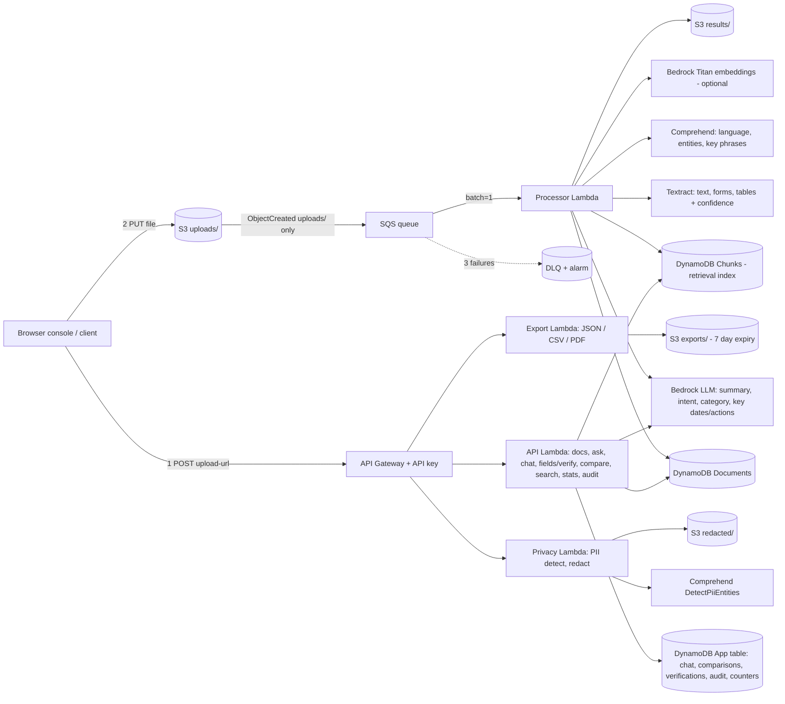

# Serverless AI Document Intelligence (AWS)

Upload a PDF/image → it's automatically OCR'd, classified, summarized, checked for low-confidence fields, mined for deadlines and actions, indexed for search, and queryable in plain English with page-level citations. No servers.

**v2 additions** (built into the same event-driven pipeline, no new always-on services):
document comparison · chat with history · confidence scores + human review · PII detection & redaction · cross-document search · analytics dashboard · key-date & action extraction · source-grounded answers · JSON/CSV/PDF export · audit trail · a browser console (`frontend/index.html`).

- API reference with sample requests/responses: [`docs/API.md`](docs/API.md)
- Architecture, data model, design decisions: [`docs/ARCHITECTURE.md`](docs/ARCHITECTURE.md) (diagram: [`docs/architecture.svg`](docs/architecture.svg))
- What changed in v2, requirement checklist, limitations, costs: [`docs/UPGRADE_REPORT.md`](docs/UPGRADE_REPORT.md)

## Run it locally (no AWS account, Windows/macOS/Linux)

Windows PowerShell, from the project folder:

```powershell
cd C:\dev\docintel
python -m venv .venv                         # once; skip if .venv already exists
.\.venv\Scripts\Activate.ps1                 # if blocked: Set-ExecutionPolicy -Scope Process -ExecutionPolicy Bypass
python -m pip install -r requirements-local.txt   # fastapi, uvicorn, pymupdf==1.28.2, pytest, pyyaml
python local_server.py                       # leave this window open; Ctrl+C stops the server
```

Open **http://127.0.0.1:8001/** (`/ui/index.html` redirects there). No API URL or key is needed: the console detects
the local server. Run the tests in a second PowerShell window:

```powershell
cd C:\dev\docintel
.\.venv\Scripts\Activate.ps1
python -m pytest                             # expected: 150 passed, 1 skipped (the live-AWS test)
python -m pytest tests\test_invoice.py -v    # one file, verbose
```

Without PyMuPDF the 11 PDF tests are skipped instead of failing.

### Using the features

| Feature | Where | Try this |
|---|---|---|
| Upload and processing stages | **Upload document** (top right); document **Overview** → *Processing stages* | Upload `samples\sample_invoice_v1.pdf`; the stages show measured durations. A scanned PDF fails at text extraction with an OCR explanation; a transient failure shows **Retry processing** |
| Invoice fields and checks | document → **Invoice checks** | Each field: value as written, normalized value, status (extracted / inferred / ambiguous / unreadable / not found / corrected), page and source line; arithmetic, tax-rate and date-order checks |
| Human review of fields | document → **Fields & review**, or **Review queue** | Confirm a value, or save a correction; the checks and findings are recomputed with the corrected value |
| Anomalies | **Anomalies** page (sidebar) | Rule, severity, evidence and suggested action per finding; **Acknowledge**, **Dismiss** (note required) or **Reopen**; every decision goes to the **Audit log** |
| Evidence-backed questions | document → **Ask** | "What is the total amount due?", "When is payment due?" (template answers citing the source line), or an unrelated question (honest "not found") |
| Version history | document → **Versions**, or the *revised version of* option in the upload dialog | Upload `sample_invoice_v1.pdf`, then `sample_invoice_v2.pdf` as its revision; the field and text differences are listed, and **Full comparison** opens Compare |

What is real and what is not in local mode (details: [`PROJECT_ANALYSIS.md`](PROJECT_ANALYSIS.md)):

| Genuine local computation | Deterministic heuristics (labelled in the UI) | Seeded fixtures | Not available locally |
|---|---|---|---|
| Every production handler in `src/`; PDF text extraction (PyMuPDF); page-aware chunking; BM25 search and retrieval; field review workflow; invoice arithmetic, tax-rate and date checks; anomaly rules; version diff (difflib); PII redaction mechanics; exports; audit trail; measured stage durations | invoice field parsing (labels, dates, amounts); extractive summary; keyword category; regex dates and amounts; frequent-word key phrases; template and extractive answers; pattern-based PII | the two "Demo fixture - Acme invoice A/B" records: scripted Textract-style text, fields and confidence scores | OCR (scanned PDFs, images); OCR confidence; tables; intent; required actions; AI comparison; semantic (embedding) search; LLM answers; person and organisation entities |

- Data is in memory and disappears when the server stops. Upload limit: 20 MB (`DOCINTEL_MAX_UPLOAD_MB`), PDFs only.
- The two seeded records (`98e7e792…`, `ef241ea5…`) are **scripted test fixtures**; they exist to demonstrate
  confidence-based review and are not the PDFs in `samples\`.
- Optional settings: `DOCINTEL_HOST`, `DOCINTEL_PORT`, `DOCINTEL_PUBLIC_URL`, `DOCINTEL_SEED_FIXTURES=0`,
  `CONFIDENCE_THRESHOLD` (default 90), `HIGH_VALUE_THRESHOLD` (default 10000; set it before starting the server, e.g.
  `$env:HIGH_VALUE_THRESHOLD = "2000"`).
- This is a local demonstration, not a production-ready system; see the limitations in `CHANGELOG_LOCAL_DEMO.md`.

## Architecture



**Why SQS between S3 and Lambda:** buffering, retries (3x), a DLQ, and a concurrency cap (5) so a burst of uploads can't blow through Textract/Bedrock quotas or your bill.

| Principle | Where it shows up |
|---|---|
| Loose coupling | S3 → SQS → Lambda; ingestion, inference, serving, privacy and export are separate functions sharing one code layer |
| Statelessness | All state in S3/DynamoDB; Lambdas hold none (chat history lives in DynamoDB) |
| Idempotency | Conditional DynamoDB write claims `(bucket,key,etag)`; duplicates skipped, stale claims reclaimed; chunk writes are keyed and stale chunks removed on retry; comparisons cached by `(docA, docB, model)` |
| Reliability | SQS retries, DLQ, partial-batch failure reporting, FAILED status; embeddings/key-date/LLM-comparison failures degrade gracefully instead of failing the request |
| Security | Private S3 + TLS-only policy, SSE on S3/SQS/DynamoDB, least-privilege IAM per function (only the Privacy function can call PII detection or write `redacted/`; nothing can delete objects), Bedrock scoped to model ARNs, API key + usage plan/throttling, presigned 5-min URLs, prompt-injection guard, CSV formula-injection guard |
| Trustworthy AI | Answers only from retrieved passages, citations + page numbers, quotes verified verbatim, explicit "not enough information"; LLM comparison separated from deterministic diff; key dates flagged `grounded` only if quoted text exists in the document |
| Human in the loop | Low-confidence fields → `REQUIRES_REVIEW`; corrections stored separately from AI values with an immutable trail |
| Observability | Structured logs (30-day retention), X-Ray, CloudWatch dashboard (Lambda, SQS, API, Bedrock tokens, audit failures), alarms → SNS email, content-free audit trail in DynamoDB |
| IaC | One SAM template: `template.yaml` |
| Cost | Pay-per-use everywhere; idle cost ≈ $0 (no OpenSearch/Kendra cluster) |

## Deploy

Prereqs: AWS account, AWS CLI configured, [SAM CLI](https://docs.aws.amazon.com/serverless-application-model/latest/developerguide/install-sam-cli.html), Python 3.12.

1. Pick a region that has Textract, Comprehend and Bedrock (e.g. `us-east-1`).
2. In the Bedrock console → **Model access**, enable your LLM (e.g. Claude 3 Haiku) **and** `Amazon Titan Text Embeddings V2`. Set `BedrockModelId` to the exact ID/inference profile shown in your console (IDs change over time). If you don't want embeddings, pass `EmbeddingModelId=""` (search and chat then use BM25 only).
3. Deploy (stack name must be lowercase — it's used in the bucket name):

```bash
sam build
sam deploy --guided --stack-name docintel \
  --parameter-overrides BedrockModelId=anthropic.claude-3-haiku-20240307-v1:0 AlertEmail=you@example.com \
                        ConfidenceThreshold=90 EmbeddingModelId=amazon.titan-embed-text-v2:0
```

Optional parameters: `ChatHistoryTtlDays` (30), `AuditRetentionDays` (365), `CorsAllowedOrigin` (`*`; set to your frontend origin in production), `ClassifierEndpointArn`.

4. Grab outputs and the API key:

```bash
aws cloudformation describe-stacks --stack-name docintel --query "Stacks[0].Outputs"
aws apigateway get-api-key --api-key <ApiKeyId> --include-value --query value --output text
```

5. Run the end-to-end demo (original behaviour; add `--tour` to walk through the v2 features):

```bash
python scripts/make_sample_docs.py samples/          # two related sample invoices (fictional data)
python scripts/demo.py <ApiUrl> <api-key> samples/sample_invoice_v1.pdf "What is the total amount due?" --tour
```

6. Open the console: open `frontend/index.html` in a browser (or host the `frontend/` folder, including `assets/`, on any static host / S3+CloudFront), then enter the API URL and key under **Settings**.

**Upgrading an existing v1 stack:** `sam build && sam deploy` updates in place. The Documents table and bucket are unchanged; two tables and two functions are added. Documents processed by v1 keep working: chat/ask chunk them on the fly, fields fall back to key-values without confidence, and they can be verified, exported, redacted and compared. Re-upload a document to get confidence scores, key dates and search indexing for it.

## API

All calls need header `x-api-key`. Optional `X-User-Id` header names the caller for chat ownership and the audit trail. Full details and examples: [`docs/API.md`](docs/API.md).

| Method | Path | Purpose |
|---|---|---|
| POST | `/documents/upload-url` | body `{"fileName":"x.pdf"}` → presigned PUT URL |
| GET | `/documents` | recent documents + status |
| GET | `/documents/{docId}` | summary, intent, category, entities (+scores), key phrases, key-values, fields (+confidence), key dates, actions, review status |
| POST | `/documents/{docId}/ask` | body `{"question":"..."}` → grounded answer **with citations** (backward compatible) |
| POST | `/documents/{docId}/chat` | body `{"question", "sessionId"?}` → conversational, grounded answer; history stored |
| GET | `/documents/{docId}/chat` | your chat sessions for the document |
| GET / DELETE | `/documents/{docId}/chat/{sessionId}` | full history / delete a conversation |
| GET | `/documents/{docId}/fields?threshold=&status=` | fields with confidence and review status |
| POST | `/documents/{docId}/fields/{fieldId}/verify` | `{"action":"confirm"}` or `{"action":"correct","correctedValue":"..."}` |
| GET | `/documents/{docId}/verifications` | immutable verification trail |
| POST | `/compare` | `{"docIdA","docIdB","force"?}` → deterministic diff + LLM interpretation |
| GET | `/comparisons/{comparisonId}` · `/documents/{docId}/comparisons` | stored comparisons |
| GET | `/search?q=&category=&status=&dateFrom=&dateTo=&limit=` | ranked cross-document search with snippets |
| POST | `/documents/{docId}/pii` | PII detection (masked previews) |
| POST | `/documents/{docId}/redact` | redacted copy written to `redacted/` (original untouched) |
| GET | `/documents/{docId}/redactions` | redaction history + download links |
| GET | `/documents/{docId}/export?format=json\|csv\|pdf` | export file + 5-minute download URL |
| GET | `/stats` | dashboard metrics |
| GET | `/documents/{docId}/invoice` | deterministic invoice fields (corrections applied), checks, findings |
| GET | `/anomalies?status=&severity=` | explainable findings across documents, with rules |
| POST | `/documents/{docId}/anomalies/{findingId}/review` | `{"action":"acknowledge"\|"dismiss"\|"reopen","note"}` (audited) |
| GET / POST | `/documents/{docId}/versions` | version timeline + deterministic differences / `{"previousDocId"}` to link |
| GET | `/documents/{docId}/audit` · `/audit?date=YYYY-MM-DD` | audit trail |

## Test & lint

```bash
pip install -r requirements-dev.txt
pytest                      # unit + integration tests against in-memory AWS fakes (no AWS needed)
cfn-lint template.yaml && sam validate --lint
# live end-to-end test against your deployed stack (costs a few cents):
DOCINTEL_API_URL=<ApiUrl> DOCINTEL_API_KEY=<key> pytest tests/integration -s
```

The offline suite runs the **real** handler code end-to-end (S3 event → processor → DynamoDB/S3 → every API route) against strict fakes in `tests/fakes.py` that parse DynamoDB expressions, reject floats/reserved words/unused placeholders like DynamoDB does, and script Bedrock/Comprehend/Textract responses. `tests/test_template.py` checks that every API route in `template.yaml` is wired to a handler (and vice versa), every referenced env var is defined, references resolve, and IAM boundaries hold.

## Notes / honest limits

- **Classification:** Comprehend's document classifier needs a custom-trained model + paid endpoint. By default the LLM assigns the category; if you train a classifier, pass its endpoint ARN as `ClassifierEndpointArn` and it takes over (`classificationMethod` records which one was used).
- **Identity:** the API uses a shared API key. `X-User-Id` is caller-asserted (good for a demo/single team, not real multi-tenant security). Use a Cognito authorizer for real users.
- **Redaction is text-level:** the redacted copy covers extracted text, fields and tables. The original PDF/image is never modified and a visually redacted PDF/image is not produced.
- **Search scale:** chunks are scanned from DynamoDB and ranked in Lambda (cheap, no cluster). Comfortable up to ~20k chunks (a few thousand documents); beyond that move to OpenSearch Serverless or a Bedrock Knowledge Base.
- **LLM output is checked, not guaranteed:** citations, quotes, key-date source text and comparison evidence are verified against the document and flagged when they don't match, but a verified quote can still be misinterpreted by the model.
- Textract multi-page PDFs are polled (up to ~13 min); fine for typical docs, not for thousand-page files.
- `/documents` and `/stats` use DynamoDB scans (OK at this scale; add a GSI by `createdAt` to grow).
- Tear down: empty the bucket, then `sam delete --stack-name docintel`.

More in [`docs/UPGRADE_REPORT.md`](docs/UPGRADE_REPORT.md#known-limitations).
