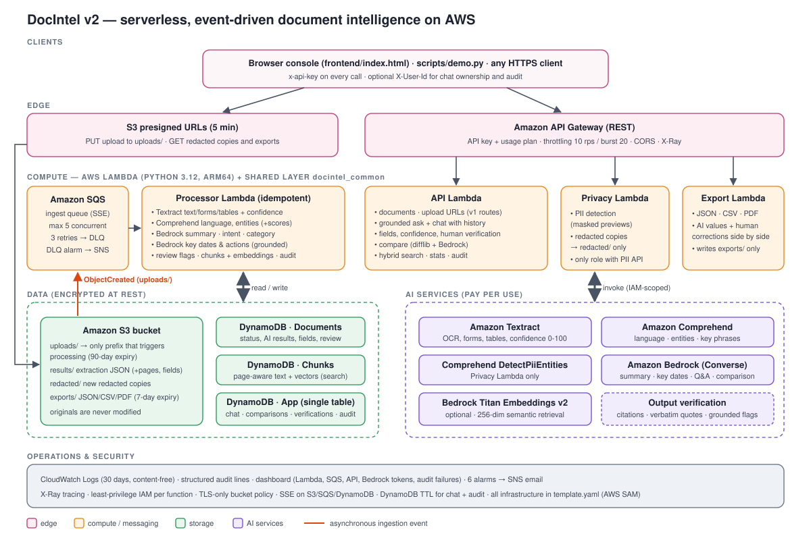
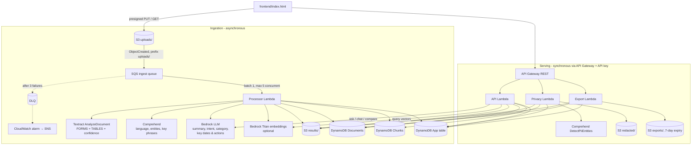

# Architecture (v2)

The v1 pipeline is unchanged in shape: **S3 → event → SQS → Lambda → Textract / Comprehend / Bedrock → DynamoDB → API Gateway → frontend**. v2 adds capabilities *inside* that pipeline (richer processor output, more API routes) plus two small, separately-permissioned Lambdas for privacy and export. No always-on service (search cluster, database server, container) was introduced.

## Components

| Component | Responsibility | Notes |
|---|---|---|
| **Processor Lambda** (`src/processor`) | OCR, NLP, LLM analysis, confidence flags, key dates/actions, chunking + embeddings, audit | Existing function, extended. Still idempotent per `(bucket, key, etag)`. Optional steps (embeddings, key dates) degrade gracefully. |
| **API Lambda** (`src/api`) | Original 4 routes + chat, grounded ask, fields/verify, compare, search, stats, audit | `app.py` router + one module per feature (`qa.py`, `review_api.py`, `comparison.py`, `search.py`, `insights.py`). |
| **Privacy Lambda** (`src/privacy`) | PII detection and redaction | Separate function so only this role holds `comprehend:DetectPiiEntities` and `s3:PutObject` on `redacted/*`. |
| **Export Lambda** (`src/export`) | JSON / CSV / PDF exports | Dependency-free PDF writer (`pdf_report.py`); writes `exports/*`, returns presigned URL. |
| **Shared layer** (`src/shared/docintel_common`) | Code reused by all functions: AWS handles, DynamoDB helpers, Bedrock wrapper, chunking, BM25/hybrid retrieval, grounding validator, diffing, PII redaction, review logic, audit | One implementation of each concern — e.g. the same retrieval code serves chat, ask and search. |
| **Frontend** (`frontend/index.html` + `frontend/assets/app.css`, `app.js`) | Console: dashboard, documents, upload, document detail (overview, fields & review, extracted text [local], ask, privacy, export, audit), review queue, search, compare, audit log, settings | No build step; talks only to the API; detects the local demo server automatically; settings stored in the browser. Local demo: see `PROJECT_ANALYSIS.md`. |

## Data model

### S3 (one bucket, prefixes)
| Prefix | Written by | Lifecycle | Triggers processing |
|---|---|---|---|
| `uploads/` | browser (presigned PUT) | 90 days | **yes** (only prefix in the notification filter) |
| `results/{docId}.json` | Processor | kept | no |
| `redacted/{docId}/{redactionId}/redacted.{json,txt}` | Privacy | 90 days | no |
| `exports/{docId}/{exportId}.{json,csv,pdf}` | Export | 7 days | no |

`results/{docId}.json` gained `pageLines` (`[{page, lines:[{text, confidence}]}]`) and `fields` (with confidence). Old result files without them are still read (`docintel_common/results.py` fills defaults).

### DynamoDB `Documents` (unchanged key: `docId`)
New attributes on the existing item (all additive, so v1 items keep working):
`fields`, `verifications`, `confidenceThreshold`, `reviewStatus`, `reviewSummary`, `reviewVersion` (optimistic lock), `keyDates`, `actions`, `chunkCount`, `processingMs`, `aiStats`, `avgOcrConfidence`, `classificationMethod`, `piiSummary`, `failedAt`; `entities[].score`.

### DynamoDB `Chunks` (new) — retrieval index
| pk `docId` | sk `chunkId` | attributes |
|---|---|---|
| doc id | `c0001…` text chunk (≤1,200 chars, never crosses a page) | `text`, `page`, `kind=text`, `ocrConfidence`, `vector` (binary float32[256], optional), `fileName` |
| doc id | `kf002…` one chunk per form field (`"key: value"`) | same, `kind=field` |

### DynamoDB `App` (new) — single-table store
| pk | sk | item | TTL |
|---|---|---|---|
| `DOC#{docId}` | `SESSION#{sessionId}` | chat session (userId, title, counts) | chat TTL |
| `CHAT#{sessionId}` | `MSG#{epochMs}#{rand}#{0\|1}` | user / assistant message (+ citations) | chat TTL |
| `CMP#{comparisonId}` | `META` | full comparison (factual + AI) | – |
| `DOC#{docId}` | `CMP#{comparisonId}` | reverse index for listing | – |
| `DOC#{docId}` | `VERIFY#{iso}#{fieldId}#v{n}` | immutable verification record (original, previous, corrected, status, who, when) | – |
| `DOC#{docId}` | `REDACT#{iso}#{redactionId}` | redaction metadata (types, counts, S3 keys, sha256) | – |
| `DOC#{docId}` or `SYSTEM` | `AUDIT#{iso}#{id}` | audit event (content-free) — GSI `gsi1`: `AUDIT#{yyyy-mm-dd}` / `{iso}#{id}` | audit TTL |
| `STATS` | `COUNTERS` | atomic counters (`count_<EVENT>`, token totals) for the dashboard | – |

## Key flows

**Processing** — claim (conditional put) → Textract → parse blocks keeping `Confidence` for lines and key/value blocks (field confidence = min(key, value)) → Comprehend (scores kept) → Bedrock summary/intent/category → Bedrock key dates/actions (each item must quote a sentence; `grounded` = quote found in the text; ISO dates validated) → flag fields under `CONFIDENCE_THRESHOLD` as `REQUIRES_REVIEW` → page-aware chunks (+ field chunks) → optional Titan embeddings (4 threads) → write chunks (and delete stale ones) → write `results/` → update the document item → audit + counters.

**Grounded Q&A / chat** — load the document's chunks (Query by `docId`) → rank with BM25 (+ cosine on embeddings) using the question plus the previous question → keep the top 6 passages within 12k chars (or the first pages if nothing matches) → Converse with numbered `<source id="S1" page="2">` passages and the last 3 exchanges → validate: citations must reference supplied sources, quotes must appear verbatim, unanswerable → standard "not enough information" text → store both messages with TTL → audit (no content).

**Comparison** — deterministic `difflib` line diff (lines are paired as "changed" only when ≥60 % similar) + field diff → Bedrock semantic comparison with both texts (≤12k chars each) → every evidence string verified against its document → stored and cached by `(A, B, model)`.

**Search** — scan Documents (metadata, filters) and Chunks (4 parallel segments) → BM25 across chunks + metadata pseudo-chunks, blended with embedding similarity → aggregate per document, top 3 snippets with pages.

**Verification** — read item (consistent) → compute new verification + review summary → conditional update on `reviewVersion` (one retry) → append immutable `VERIFY#` record → `FIELD_VERIFIED` (+ `RESULT_MODIFIED` when the effective value changes).

**Redaction** — flatten lines, `"key: value"` fields and table cells → Comprehend PII on ≤90 KB pieces → redact key/value/cell ranges independently → write new S3 objects with SSE → metadata + audit. Never writes to `uploads/` or `results/` (and IAM forbids it).

## Design decisions

| Decision | Why | Alternative considered |
|---|---|---|
| Retrieval index in DynamoDB + BM25/cosine in Lambda | $0 idle cost, no new service, deterministic and testable; fine for a student-scale corpus | OpenSearch Serverless (vector search, but billed per OCU-hour with a minimum capacity, i.e. a three-digit monthly bill even when idle), Bedrock Knowledge Bases (needs a vector store), Kendra (expensive) |
| Embeddings optional (`EmbeddingModelId=""`) | Lexical BM25 already works; embeddings add paraphrase matching for ~$0.02 per million tokens | Mandatory embeddings would break deployments without model access |
| Separate Privacy and Export functions | Least privilege: PII API and `redacted/`, `exports/` writes are isolated | One big API function with every permission |
| Shared Lambda layer | One implementation of retrieval/grounding/audit/etc. used by all functions | Copy-pasted helpers per function |
| Corrections next to, not over, AI values | Requirement: never silently overwrite; enables auditing model accuracy | Updating `fields[].value` in place |
| Quote/evidence verification | Cheap, deterministic hallucination check for answers, key dates and comparisons | Trusting model output |
| Audit in DynamoDB + structured CloudWatch line | Queryable per document/day via API; CloudWatch Logs Insights for ops; content-free by construction (`audit._sanitize`) | CloudTrail Lake (paid per GB ingested), CloudWatch only (not queryable per document through the API) |
| Presigned URLs for exports/redactions | Avoids API Gateway 10 MB/binary limits; downloads expire in 5 minutes | Returning files through API Gateway |
| Dependency-free PDF writer | No native wheels to build for arm64, tiny cold start | ReportLab/fpdf2 |

## Security summary

* IAM per function (see `template.yaml`); `tests/test_template.py` asserts the boundaries: only Privacy can detect PII or write `redacted/`, only Processor writes `results/`, only Export writes `exports/`, no function can delete S3 objects, Bedrock is scoped to foundation-model / inference-profile ARNs.
* Encryption at rest: S3 SSE-S3 (explicit SSE on new objects too), DynamoDB SSE, SQS SSE; TLS-only bucket policy.
* No secrets in code; the only credential is the API Gateway key, retrieved from AWS by the operator.
* Logs: no document text, questions, answers, field values or search terms are logged; PII detection returns masked previews and stores only counts.
* Prompt-injection guard: documents are always passed as untrusted data inside tags with instructions to ignore embedded instructions; outputs are validated.
* Browser: all rendered values are HTML-escaped; CSV cells are neutralised against formula injection; CORS origin is a stack parameter.
